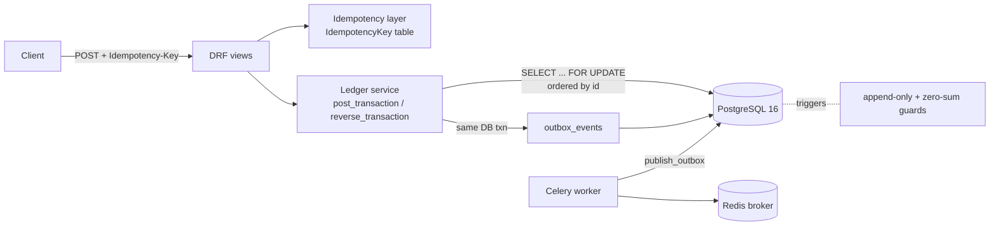

# Ledger Wallet API

A double-entry payments ledger and multi-currency wallet API built with **Django 5, Django REST Framework, PostgreSQL 16, Celery and Redis**.

It is built around the things that matter in real money systems: money is never created or lost, retries never charge twice, concurrent transfers never deadlock or overdraw a wallet, and the history can't be rewritten.

## Features (current)

- Wallets: one per user per currency (NGN, USD, GBP)
- Deposits (credited from a `system_cash` account) and wallet-to-wallet transfers
- Reversals that post offsetting entries (the original is never edited)
- A required `Idempotency-Key` header on every POST. A replay returns the stored response. Reusing a key with a different body returns `422`.
- Transaction history with cursor pagination
- Transactional outbox (`OutboxEvent`) written in the same DB transaction as each posting, plus a Celery relay task
- Append-only ledger enforced both in Django and by **Postgres triggers**
- A **deferred Postgres constraint trigger** that rejects any transaction whose entries don't sum to zero per currency

## Architecture



### Data model

| Table | Purpose |
|---|---|
| `Account` | user wallets and system accounts (`system_cash`, `fees`, `suspense`), with a cached `balance` (minor units) and `version` |
| `Transaction` | `type`, `status` (pending/posted/reversed), unique `idempotency_key`, `reference`, `metadata`, `reverses` |
| `Entry` | signed `amount` (BigInteger minor units) against one account. Append-only. |
| `IdempotencyKey` | key + scope, request hash, stored response body and status |
| `OutboxEvent` | `event_type`, `payload`, `published_at` |

## Money-flow example: a transfer

Ada sends Bola ₦25.00 (2500 kobo). One `Transaction` is created with two `Entry` rows:

| Entry | Account | Amount (kobo) |
|---|---|---|
| 1 | Ada's NGN wallet | **-2500** |
| 2 | Bola's NGN wallet | **+2500** |
| | **Sum** | **0** ✅ |

A deposit of ₦100 into Ada's wallet works the same way: `system_cash NGN -10000` and `Ada +10000`. Over the whole ledger, every currency always sums to exactly zero, and the tests check this.

## Design decisions

- **Double-entry.** Every movement is a balanced set of entries, so money can only move, never appear. Balances can always be rebuilt from `entries`. The cached `Account.balance` is updated in the same DB transaction, and the tests check it against the sum of entries.
- **Integer minor units.** Amounts are `BIGINT` kobo or cents. Floats are rejected by the service and the API.
- **Idempotency.** Clients send `Idempotency-Key`. The request body is hashed, and the response is stored and replayed. A key reused with a different body returns `422`. The service layer is idempotent too, through the unique `Transaction.idempotency_key`, so a race between two identical requests still produces a single posting.
- **Lock ordering.** `post_transaction` runs inside `transaction.atomic()` and locks every involved account with `SELECT ... FOR UPDATE` **in ascending id order**. Two opposite transfers (A→B and B→A) can't deadlock, and the overdraft check sees committed balances.
- **No overdraft on user wallets.** System accounts can go negative (for example, `system_cash` reflects money held at the bank).
- **Append-only.** `Entry` rows can never be updated or deleted. A posted `Transaction` can only move from `posted` to `reversed`. Mistakes are fixed with reversing entries. This is enforced in model `save()`/`delete()` and by DB triggers, which also catch `QuerySet.update()` and raw SQL.
- **Zero-sum at the DB level.** `ledger_entry_balanced` is a `DEFERRABLE INITIALLY DEFERRED` constraint trigger, so a transaction's entries are checked at COMMIT.
- **Transactional outbox.** Events are written in the same transaction as the posting, so an event exists if and only if the money moved. A Celery task relays them later.

## API

| Method | Path | Notes |
|---|---|---|
| POST | `/api/wallets/` | `{"username": "ada", "currency": "NGN"}` (or `owner` user id) |
| GET | `/api/wallets/{id}/` | wallet and balance |
| POST | `/api/wallets/{id}/deposit/` | `{"amount": 10000, "reference": "..."}` |
| POST | `/api/transfers/` | `{"source_wallet": 1, "destination_wallet": 2, "amount": 2500}` |
| GET | `/api/wallets/{id}/transactions/?page_size=20` | cursor-paginated entries, newest first |

Every POST requires an `Idempotency-Key` header. Ledger rule violations (insufficient funds, currency mismatch) return `422` with `{"error": "<code>"}`.

## Running it

### With Docker

```bash
cp .env.example .env
docker compose up --build
# API on http://localhost:8000/api/ (migrations run on start)
docker compose exec api pytest
```

### Locally (Python 3.12 + a running PostgreSQL 16)

```bash
python -m venv .venv && source .venv/bin/activate
pip install -r requirements.txt
cp .env.example .env && set -a && source .env && set +a
createdb -h localhost -U postgres ledger   # skip if it already exists
python manage.py migrate
python manage.py runserver
pytest            # 26 tests, including the concurrency test
make lint
```

### Try it

```bash
curl -s -X POST localhost:8000/api/wallets/ -H 'Content-Type: application/json' \
  -H 'Idempotency-Key: w1' -d '{"username":"ada","currency":"NGN"}'
curl -s -X POST localhost:8000/api/wallets/1/deposit/ -H 'Content-Type: application/json' \
  -H 'Idempotency-Key: d1' -d '{"amount":10000}'
```

## Tests

- `test_posting.py`: balancing, currency mismatch, overdraft, non-integer amounts, service idempotency, reversals, model and DB append-only guards, and the deferred zero-sum trigger
- `test_api.py`: endpoints, required header, replay, same key with a different body returning 422, overdraft, cursor pagination
- `test_concurrency.py`: 100 transfers fired from 40 concurrent threads on real Postgres (`transaction=True`). It checks that total money is conserved, no wallet goes negative, the cached balances equal the sum of entries, and there are no deadlocks.

## Roadmap

- **Week 3:** mock payment provider, HMAC-signed webhooks (dedupe on `provider_event_id`, Celery retries with backoff), withdrawals with a pending→posted flow
- **Week 4:** holds and captures, refunds, multi-currency with fixed FX rates, a fees account
- **Week 5:** nightly reconciliation against the provider, JWT auth, rate limiting, audit logs
- **Week 6:** structured logs, Prometheus metrics, OpenTelemetry traces, Locust load tests, deployment to Fly.io or Render, Swagger docs
