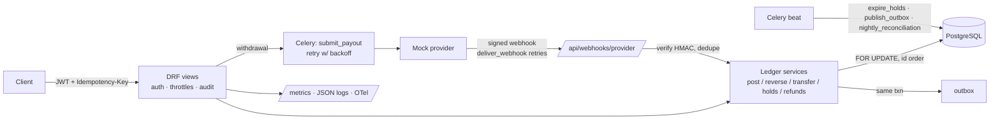

# Ledger Wallet API

### Explore the demo

The [Next.js playground](frontend/README.md) adds a multi-currency dashboard,
guided transfer demo, and visual Ledger Explorer. Run `npm ci` and `npm run dev`
inside `frontend/` to explore it without a database or login. The playground and
failure lab use in-memory data; the **Live API** workspace signs in to Django and
reads and posts real PostgreSQL ledger entries over mock payment rails.
See the [runbook](docs/RUNBOOK.md), [validation evidence](docs/VERIFICATION.md),
and [free hosting setup](docs/FREE-HOSTING.md) for setup and deployment.
Publication is pending Vercel/Neon account connections and hosted verification.
The retained [Render Blueprint](render.yaml) uses paid resources and is not approved.

Latest local validation: **158 PostgreSQL-backed tests, 96% measured coverage
of ledger/provider code, 10 frontend tests**, type checking, production build, and a separate Redis/Celery
worker check. Published operational evidence records its exact scope; the older
load-test result below has not been re-measured during this upgrade.

A production-style **double-entry payments ledger and wallet API** built with Django + DRF + PostgreSQL + Celery.
It covers multi-currency wallets, idempotent transfers with fees, FX, card-style holds, refunds and reversals,
a mock payment provider with HMAC-signed webhooks, withdrawals settled through a suspense account, nightly
reconciliation, JWT auth with per-user ownership, throttling, an audit trail, and full observability
(JSON logs with request ids, Prometheus metrics, optional OpenTelemetry tracing, OpenAPI docs).

**158 tests · 96% ledger/provider coverage** (excluding tests and migrations) · Historical load result: **112 req/s, 0 failures, zero drift** (KYC enforced)
(see [Load test](#load-test)).

## Features

| Area | What's there |
|---|---|
| Core ledger | Signed BIGINT minor units, balanced entries per transaction, `SELECT … FOR UPDATE` in id order, append-only entries plus a DB-level deferred zero-sum trigger, transactional outbox |
| Idempotency | `Idempotency-Key` on every money-moving POST, scoped per user. Replays return the stored response with `Idempotent-Replayed: true`; same key with a different body → `422` |
| Deposits | Mock provider checkout → **HMAC-SHA256 signed webhook** (`t=…,v1=…`, 5-min tolerance) → dedupe by `provider_event_id` → deposit keyed on the provider charge ref |
| Withdrawals | `pending` → funds moved wallet → **suspense**; payout submitted by a Celery task with **exponential backoff + jitter**; `payout.succeeded` → suspense → cash (`posted`); `payout.failed` → hold reversed (`failed`) |
| Holds | Place (reduces *available* balance), capture full or partial (remainder released), release, auto-expiry via Celery beat |
| Refunds and reversals | Partial or full refunds of transfers and captures, capped at the remaining refundable amount (fee kept). Admin-only full reversal |
| FX | Fixed `FxRate` table (USD/NGN, GBP/NGN, GBP/USD and inverses). Cross-currency transfers go through per-currency `fx` system accounts, so **each currency still sums to zero** |
| Fees | Configurable `TRANSFER_FEE_BPS` / `MIN` / `MAX` (default 0.5%), charged on top and credited to the `fees` account |
| Reconciliation | Nightly task (02:00 UTC) and admin endpoint: provider charges ↔ ledger deposits, payouts ↔ withdrawal status, cached balances ↔ `SUM(entries)`, per-currency zero sum → `ReconciliationReport` |
| Auth | JWT (simplejwt): register, token, refresh. Users see and spend only their own wallets (others' return 404). Merchants capture and refund. Staff-only deposit, reverse, reconciliation and audit endpoints |
| Throttling | Anon, user and a tighter **money** scope. Rates are read from settings or env at request time |
| Audit | Append-only `AuditLog` for every money-moving action: actor, action, transaction, object, amount, **request id**, IP. System actions (webhooks, expiry) included |
| Observability | JSON logs with `request_id` (and `trace_id` when tracing is on); `X-Request-ID` is accepted or generated and echoed; Prometheus `/metrics`; OpenTelemetry (off by default); `/healthz` |
| Docs | OpenAPI 3 at `/api/schema/`, Swagger UI at `/api/docs/`, ReDoc at `/api/redoc/` (schema validates with zero warnings in CI) |

## Architecture



### Accounts

| Type | Purpose |
|---|---|
| `user_wallet` | one per user per currency; may not go below **available** balance (`balance − held_amount`) |
| `system_cash` | money at the bank / provider (negative = owed to customers) |
| `suspense` | withdrawals in flight |
| `fees` | collected transfer fees |
| `fx` | one per currency; the FX desk's position |

### Money flows (minor units)

| Operation | Entries |
|---|---|
| Deposit ₦100 (webhook) | cash −10000 · wallet +10000 |
| Transfer ₦1,000, 0.5% fee | sender −100500 · receiver +100000 · fees +500 |
| FX ₦150,000 → $100 | NGN wallet −15075000 · fx_NGN +15000000 · fees +75000 ‖ fx_USD −10000 · USD wallet +10000 |
| Hold ₦200 | *no entries*: `held_amount += 20000` |
| Capture ₦150 of it | payer −15000 · merchant +15000 (rest released) |
| Withdrawal ₦300 | wallet −30000 · suspense +30000 → on success: suspense −30000 · cash +30000; on failure: reversal of the first |

## Design decisions

- **Double-entry.** Every movement is a balanced set of entries, so money can only move, never appear. Balances can always be rebuilt from `entries`. The cached `Account.balance` is updated in the same DB transaction, and the tests check it against the sum of entries.
- **Integer minor units.** Amounts are `BIGINT` kobo or cents. Floats are rejected by the service and the API.
- **Idempotency.** Clients send `Idempotency-Key`. The request body is hashed, and the response is stored and replayed. A key reused with a different body returns `422`. The service layer is idempotent too, through the unique `Transaction.idempotency_key`, so a race between two identical requests still produces a single posting.
- **Lock ordering.** `post_transaction` runs inside `transaction.atomic()` and locks every involved account with `SELECT ... FOR UPDATE` **in ascending id order**. Two opposite transfers (A→B and B→A) can't deadlock, and the overdraft check sees committed balances.
- **No overdraft on user wallets.** System accounts can go negative (for example, `system_cash` reflects money held at the bank).
- **Append-only.** `Entry` rows can never be updated or deleted. A posted `Transaction` can only move from `posted` to `reversed`. Mistakes are fixed with reversing entries. This is enforced in model `save()`/`delete()` and by DB triggers, which also catch `QuerySet.update()` and raw SQL.
- **Zero-sum at the DB level.** `ledger_entry_balanced` is a `DEFERRABLE INITIALLY DEFERRED` constraint trigger, so a transaction's entries are checked at COMMIT.
- **Transactional outbox.** Events are written in the same transaction as the posting, so an event exists if and only if the money moved. A Celery task relays them later.
- **Provider-ref keyed deposits.** A webhook's deposit uses `charge:<provider_ref>` as its idempotency key, so even a re-sent event with a *new* event id can't double-credit. Duplicate event ids return `200 {"status":"duplicate"}`, so the provider stops retrying.
- **Suspense for withdrawals.** Money leaves the wallet immediately, so it can't be double-spent while the payout is in flight. A failure is a *reversal* of the hold transaction, not an edit.
- **Holds don't post entries.** Authorisations change `held_amount` under the same row lock as postings. Only a capture moves money. That keeps the ledger free of noise from abandoned authorisations.
- **Ownership by 404.** Other users' wallets, holds and withdrawals return 404 rather than 403, so ids can't be enumerated.

## API

All amounts are integers in minor units. Every money-moving POST needs `Idempotency-Key`. Auth is `Authorization: Bearer <access>`.
The full schema is in [`openapi.yaml`](openapi.yaml), and Swagger UI is served at `/api/docs/`.

| Method | Path | Who |
|---|---|---|
| POST | `/api/auth/register/`, `/api/auth/token/`, `/api/auth/token/refresh/` | anyone |
| GET, POST | `/api/wallets/` | user (own wallets; staff can create for others) |
| GET | `/api/wallets/{id}/`, `/api/wallets/{id}/transactions/` (cursor pagination) | owner / staff |
| POST | `/api/transfers/` (same- or cross-currency) | owner of source |
| POST | `/api/wallets/{id}/withdrawals/` · GET `/api/withdrawals/{id}/` | owner |
| POST | `/api/wallets/{id}/holds/` · GET `/api/holds/{id}/` | payer (view: payer or merchant) |
| POST | `/api/holds/{id}/capture/`, `/api/holds/{id}/release/` | merchant |
| POST | `/api/transactions/{id}/refund/` | payee (merchant / receiver) |
| POST | `/api/transactions/{id}/reverse/` | **staff** |
| POST | `/api/wallets/{id}/deposit/` (back-office credit) | **staff** |
| GET, POST | `/api/admin/reconciliation/`, GET `/api/admin/reconciliation/{id}/` | **staff** |
| GET | `/api/admin/audit-logs/?action=transfer` | **staff** |
| GET | `/api/fx-rates/` | user |
| POST | `/api/webhooks/provider/` | provider (HMAC signature, no JWT) |
| POST | `/provider/charges/` | mock provider's "hosted checkout" |
| GET | `/metrics`, `/healthz`, `/api/schema/`, `/api/docs/`, `/api/redoc/` | anyone |

Errors: `422 {"error": "insufficient_funds" | "currency_mismatch" | "not_refundable" | "hold_not_active" | …}`,
`409 wallet_exists`, `400 invalid_signature`, `429` when throttled.

## Onboarding & KYC (tiered)

Signup is **instant**. Every new user starts at **tier 0** and can use the product straight away within small limits.
Submitting KYC puts the user in an admin review queue. **Approval raises them to tier 1** and issues virtual bank accounts.

| | Tier 0 (no KYC) | Tier 1 (KYC approved) |
|---|---|---|
| Wallet currencies | NGN only | NGN, USD, GBP |
| Max balance per wallet | ₦50,000 · $35 · £28 | ₦10,000,000 · $7,000 · £5,600 |
| Daily outflow (transfers, FX, captures, withdrawals) | ₦20,000 · $14 · £11 | ₦5,000,000 · $3,500 · £2,800 |
| Withdrawals / FX / virtual accounts | ✗ / ✗ / ✗ | ✓ / ✓ / ✓ |

Limits live in `settings.KYC_TIERS` and are enforced inside `post_transaction`, while the account rows are locked, so no
API path can bypass them. Refunds and reversals are exempt from the balance cap. Errors: `403 kyc_required` (capability
or currency not allowed for the tier) and `422 limit_exceeded`. Set `KYC_ENFORCED=0` to switch enforcement off.

| Endpoint | Who | |
|---|---|---|
| `GET /api/kyc/` | user | tier, status, limits, rejection reason (ID number masked) |
| `POST /api/kyc/` | user | submit or resubmit `full_name, date_of_birth, country, id_type (BVN/NIN/PASSPORT…), id_number` → `pending` |
| `GET /api/admin/kyc/?status=pending` | staff | review queue, cursor-paginated (`approved`, `rejected`, `none`, `all` also accepted) |
| `POST /api/admin/kyc/{id}/approve/` | staff | tier 1, backfill virtual accounts, audit + outbox `kyc.approved` |
| `POST /api/admin/kyc/{id}/reject/` `{reason}` | staff | audit + outbox `kyc.rejected`; the user sees the reason and can resubmit |

**Virtual accounts (mock).** Each tier-1 wallet gets one receiving account, shown in wallet responses as `virtual_account`:
NGN gets a 10-digit NUBAN at "Ledger MFB (mock)" with a valid CBN check digit; GBP gets sort code `99-00-01` plus 8 digits;
USD gets ABA routing number `999000014` plus a 12-digit account number. Numbers are derived from an HMAC of the wallet id, so
they are deterministic, and they are collision-checked under a unique constraint with retries. They are **not real bank accounts**.

**Inbound bank transfers.** The mock provider (`POST /provider/bank-transfers/`) sends a signed `bank_transfer.received` webhook.
The API credits the wallet that owns the account number (type `bank_transfer_in`, deduped on `banktx:<ref>`). Money for an
unknown account, a currency mismatch or a tier-limit breach is accepted but **parked in suspense** (`inbound_unallocated`).
Reconciliation reports it as an `unallocated_inbound` mismatch so ops can follow up.

**Resolving suspense (staff only).** Every parked item gets exactly one decision. A repeat of the same decision returns
the original result; a conflicting second decision returns `409 suspense_invalid_state`.

| Endpoint / command | Effect |
|---|---|
| `GET /api/admin/suspense/` · `manage.py suspense list` | unresolved items: amount (minor units and formatted), reason, account number, sender |
| `POST /api/admin/suspense/{txn}/allocate/` `{wallet_id, reason?, override_limits?}` · `manage.py suspense allocate <txn> --wallet <id> [--override-limits --reason ..] --actor <staff>` | posts suspense → wallet (`suspense_allocation`), same currency only |
| `POST /api/admin/suspense/{txn}/return/` `{reason?}` · `manage.py suspense return <txn>` | mock refund to the sender: suspense → system_cash (`suspense_return`) |

Both actions are audit-logged (`suspense.allocate` / `suspense.return`) and emit outbox events (`suspense.allocated` /
`suspense.returned`). Once resolved, an item is no longer flagged and reconciliation goes back to **clean**.

**KYC limits on allocation:** an allocation is a normal credit, so the target wallet's tier limits apply (for example,
`422 limit_exceeded` if it would go over the tier-0 balance cap). Staff can pass **`override_limits: true`**, which
requires a reason of at least 3 characters. The override skips only the KYC tier checks, never the balance or
currency checks. It is recorded in the transaction metadata (`admin_override_limits`), on the resolution row, in the
audit log and in the outbox event.

**Holds and the daily limit:** placing a hold is checked against the daily outflow limit. The check counts posted
outflow today, plus today's still-active holds, plus the new hold. Released or expired holds free the headroom, and
capture is checked again when it posts.

**Errors carry machine fields:** `limit_exceeded` and `insufficient_funds` bodies include formatted text, e.g.
`"Daily outflow limit for tier 0 is ₦20,000.00 NGN (used ₦0.00 NGN, requested ₦25,000.00 NGN)"`. They also carry
`amount_minor`, `currency`, `limit_minor`, `used_minor` / `balance_minor` / `available_minor`, `limit` and `tier`.

### Why tiered onboarding instead of manual approval of every signup

- **No friction at signup.** Users who wait days for an admin before they can do anything mostly never come back. Tier 0
  lets them try the product right away.
- **Risk follows exposure.** With small caps, NGN only, no withdrawals and no FX, an unverified account can't be used to
  move meaningful money. Checks are concentrated where the risk is.
- **Mirrors real regulation.** The CBN's tiered KYC for Nigerian wallets and the "simplified due diligence" thresholds
  elsewhere work the same way: identity checks scale with limits.
- **Ops time goes where it matters.** Admins review only the users who want higher limits, in a single queue with
  audit trails and events, not every signup.
- **Enforced in one place.** Limits are applied in the posting layer, so new endpoints inherit them automatically.

## Running it

### With Docker

```bash
cp .env.example .env
make up          # postgres, redis, api (gunicorn), worker, beat
# API: http://localhost:8000/api/  ·  docs: http://localhost:8000/api/docs/
```

### Locally (Python 3.12+ and PostgreSQL 16+)

```bash
python -m venv .venv && . .venv/bin/activate
pip install -r requirements.txt
cp .env.example .env && set -a && . ./.env && set +a
export CELERY_EAGER=1            # run Celery tasks inline: no Redis or worker needed
python manage.py migrate
python manage.py runserver       # threaded, so inline webhooks can call back into it
```

With a real worker, run `make worker` and `make beat` (needs Redis), and leave `CELERY_EAGER=0`.

### Demo (fresh DB, live server, the whole flow)

```bash
python scripts/demo.py     # creates DB "ledger_demo", migrates, starts gunicorn, drives the API over HTTP
```

It registers users, gets JWTs, opens wallets, deposits via a signed webhook (plus a replay and a forged
signature), then runs a transfer with a fee, an FX transfer, a hold with partial capture, a refund, a
successful withdrawal and a failed one that gets reversed, and admin reconciliation. It finishes by printing
every account with `balance == SUM(entries)` and each currency summing to 0.
A sample run is in the project's `demo_output.txt`.

### Try it by hand

```bash
curl -s -XPOST localhost:8000/api/auth/register/ -H 'Content-Type: application/json' \
  -d '{"username":"ada","password":"ada-pass-123"}'
TOKEN=$(curl -s -XPOST localhost:8000/api/auth/token/ -H 'Content-Type: application/json' \
  -d '{"username":"ada","password":"ada-pass-123"}' | python -c 'import sys,json;print(json.load(sys.stdin)["access"])')
curl -s -XPOST localhost:8000/api/wallets/ -H "Authorization: Bearer $TOKEN" -H 'Idempotency-Key: w1' \
  -H 'Content-Type: application/json' -d '{"currency":"NGN"}'
# fund it through the mock provider (signed webhook back to the API):
curl -s -XPOST localhost:8000/provider/charges/ -H 'Content-Type: application/json' \
  -d '{"wallet_id":1,"amount":500000,"currency":"NGN"}'
curl -s localhost:8000/api/wallets/1/ -H "Authorization: Bearer $TOKEN"
```

### Operations

- `python manage.py reconcile`: runs reconciliation and prints the report as JSON.
- Beat schedule: `expire_holds` every 60s, `publish_outbox` every 10s, `nightly_reconciliation` at 02:00 UTC.
- Logs: one JSON object per line (`LOG_FORMAT=plain` for humans). Send `X-Request-ID` to correlate; it is echoed back and stored on audit rows.
- Metrics: `http_requests_total{method,route,status}`, `http_request_duration_seconds`, `ledger_transactions_posted_total{type}`, `webhook_events_total{result}`, `reconciliation_mismatches_total{kind}`. The registry is per process, so run gunicorn with **one worker + threads** (as in the Dockerfile) or switch to prometheus multiprocess mode.
- Tracing: `OTEL_ENABLED=1` (and `OTEL_EXPORTER_OTLP_ENDPOINT=…`, or `OTEL_EXPORTER=console`) instruments Django and adds `trace_id` to logs.

### Deploy (Fly.io)

[`fly.toml`](fly.toml) defines app, worker and beat processes, a `release_command` for migrations, and a `/healthz` check.
**Not deployed.** To deploy, you'd run `fly launch --no-deploy`, attach Postgres and Redis, run `fly secrets set SECRET_KEY=… PROVIDER_WEBHOOK_SECRET=…`, then `fly deploy`.

## Tests

Current results and acceptance scope are in [verification](docs/VERIFICATION.md).
The suite breakdown below records the original 135-test baseline.

```bash
pytest                         # 135 tests, real PostgreSQL (config.settings_test: Celery eager, KYC enforced)
pytest --cov                   # coverage (see .coveragerc)
ruff check . && ruff format --check .
```

Original baseline: **135 passed in ~18s, 95% coverage** (1,762 statements, 84 missed). All suites run with `KYC_ENFORCED=1`: ledger-mechanics tests use KYC-verified (tier-1) users from the `make_wallet` fixture.

| File | Covers |
|---|---|
| `test_posting.py` (15) | balanced posting, zero-sum, append-only and DB triggers, reversal, idempotency, overdraft |
| `test_api.py` (10) | wallet CRUD, idempotent replay / 422, overdraft, currency mismatch, cursor pagination |
| `test_concurrency.py` (1) | 100 concurrent transfers from 40 threads: no lost updates, no deadlocks, balances = entries |
| `test_week3_provider.py` (16) | signature valid / wrong secret / stale / malformed, event dedupe, provider-ref dedupe, deliver-webhook retries, payout outage → backoff retries, withdrawal success and failure reversal, suspense back to 0 |
| `test_week4.py` (24) | hold place / capture full and partial / release / expiry / idempotent capture, available balance, refunds (partial, cap, fee kept), fee math, FX conversion and per-currency zero-sum |
| `test_week5.py` (16) | JWT register / token / refresh, ownership (404s), admin-only (403s), merchant-only capture, payee-only refund, user / money / anon throttles (429), audit trail incl. system actions, reconciliation clean and each mismatch type, admin endpoint, Celery task, management command |
| `test_week6_observability.py` (7) | request ids (generated / accepted / sanitised), JSON log shape, request id on audit rows, `/metrics`, OpenAPI and Swagger, tracing off by default and emitting spans when enabled |

CI (GitHub Actions) runs against Postgres 16: ruff, `makemigrations --check`, migrate, pytest with coverage,
and OpenAPI validation with `--fail-on-warn`. It uploads coverage.xml and openapi.yaml.

## Load test

```bash
# terminal 1: server with throttles raised (KYC stays on; seeded users are approved to tier 1)
CELERY_EAGER=1 THROTTLE_ANON=100000/min THROTTLE_USER=100000/min THROTTLE_MONEY=100000/min \
  gunicorn config.wsgi:application -w 1 --threads 16 -b 127.0.0.1:8000
# terminal 2
make loadtest            # locust: 50 users, ramp 10/s, 60s, headless
python manage.py reconcile   # must be "clean"
```

Real run on 2026-10-24 with **`KYC_ENFORCED=1`** (8-vCPU VM shared by Postgres, gunicorn and Locust): **6,716 requests,
0 failures, 112 req/s, p50 240 ms, p95 630 ms**. Transfers ran at ~51/s, with p50 470 ms and p95 690 ms. Each seeded user
submits KYC over the API and is approved to tier 1 through the service layer (`ledger.kyc.approve`). Because of that, the
Locust process needs DB access (the same `POSTGRES_*` env as the server).

Afterwards, reconciliation was **clean**: 50/50 charges matched, 0 unallocated inbound, no balance drift, NGN entries
summed to 0 across 9,257 entries, and all 50 users were at tier 1 with a virtual account. The earlier run without KYC
reached 143 req/s. The tier checks (a SUM over today's outflow, taken under the row lock) cost about 20%. See
[`loadtest/results/SUMMARY.md`](loadtest/results/SUMMARY.md).

## Project layout

```
config/          settings (+ settings_test), urls, celery, otel
ledger/          models, services (posting, transfer, FX, fees, refunds), holds, withdrawals, webhooks,
                 signing, reconciliation, audit, permissions, throttling, observability, metrics, views
provider/        mock payment provider: charges, payouts, signed webhook delivery with retries
loadtest/        locustfile + results
scripts/demo.py  end-to-end demo on a fresh DB
```

## Known limitations

- KYC and bank accounts are mocks: there are no real BVN/NIN lookups or document uploads, and the virtual account numbers are fake.
- Returning money to the sender is a ledger-side mock (suspense → system_cash plus an `rf_…` reference). No outbound payment is sent to the provider.
- A parked item is allocated in full to one wallet. Splitting it across wallets isn't supported.
- FX rates are a fixed seeded table. A real system would snapshot live quotes and manage FX-desk P&L.
- The provider is in-process (same DB) for convenience. It talks to the API only over HTTP webhooks.
- Locmem is the default cache for throttles. Set `USE_REDIS_CACHE=1` (as docker-compose and fly.toml do) to share limits across processes.
